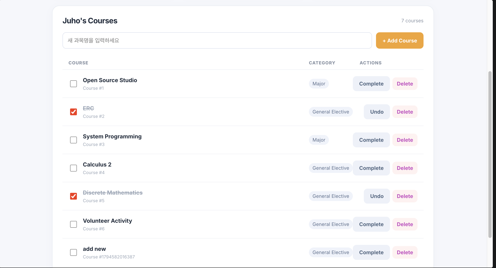
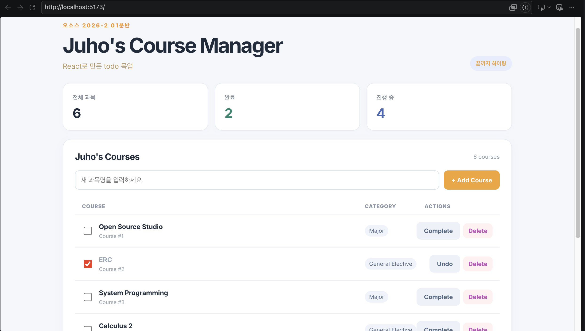
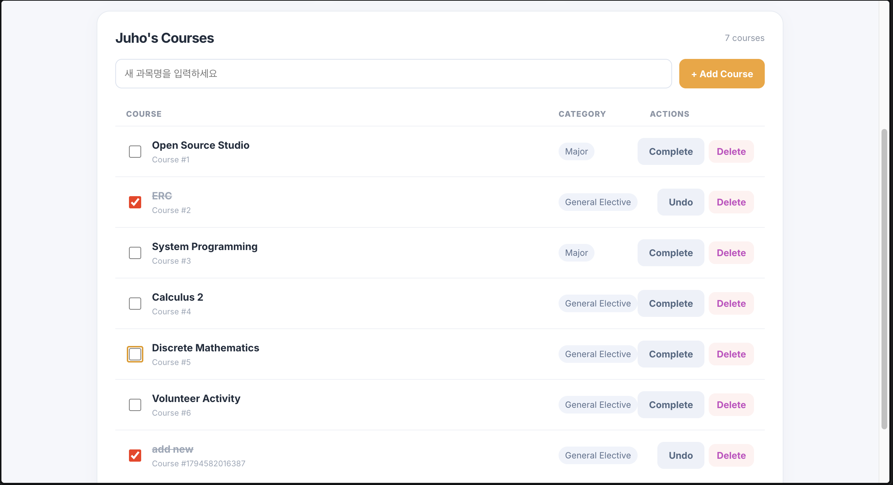
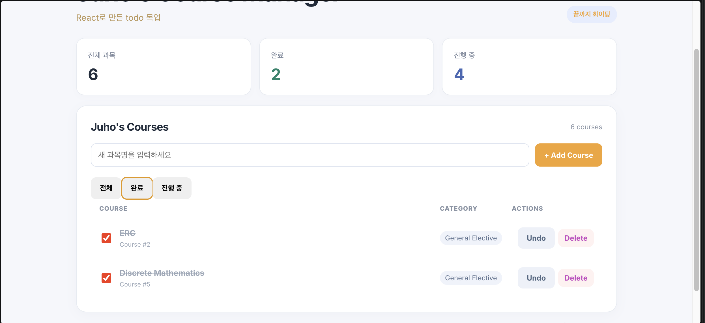

# OSS Week 11 — React Course Manager (Student Starter)

React + Vite 기반 학생 배포용 Sample Project입니다. **조회와 삭제는 완성**, 등록 및 완료 변경은 학생이 직접 구현하도록 `TODO`로 남겨두었습니다.

## 실행 방법

Node.js 20.19+ 또는 22.12+ 권장.

```bash
npm install
npm run dev
```

브라우저에 표시되는 Local URL에 접속하세요. 빌드 테스트: `npm run build`.

## 소스 구조

- `src/App.jsx`: 페이지 전체 레이아웃
- `src/components/CourseList.jsx`: State 및 목록, 삭제 로직, **TODO 1/2**
- `src/components/CourseItem.jsx`: Props로 데이터를 받고 이벤트 콜백 호출
- `src/data/courses.js`: 초기 과목 데이터
- `src/App.css`: 전체 디자인

## 수행 내용

1. 코드를 실행하고 목록 조회·삭제를 확인합니다.
2. 초기 과목 5개 이상, 제목, CSS 3곳 이상 변경합니다.
3. `CourseList.jsx`의 **TODO 1**: 과목 등록 (빈 값 입력 방지, 고유 id 지정, State 업데이트).
4. `CourseList.jsx`의 **TODO 2**: 완료 체크박스 클릭 시 `completed` 상태 변경.
5. 선택: 검색/필터, 이름 수정 기능 추가.
6. GitHub에 Commit/Push 후 Vercel에 배포합니다.
7. README에 프로젝트 소개, 주요 코드 분석 2개, 변경 내용, Weekly Review, GitHub URL, Vercel URL을 정리합니다.

## 확인할 질문

- `CourseList`와 `CourseItem`의 역할은?
    CouseList는 부모로 CourseItem은 자식. 따라서 CourseList에 있는 함수를 호출한다.
- 왜 `courses`를 직접 수정하지 않고 `setCourses()`를 사용할까요?
    React는 state의 저장 방식이 달라서 직접 수정시에 바뀌지 않아서 useState사용함.
- `map()`과 `filter()`는 각각 어떤 목적인가요?
    map은 하나하나 배열 모든 요소 그리는 함수이고, filter은 주어진 조건을 통과하는걸 남기는것.
- `course`, `onDelete`, `onToggle` Props는 어디에서 전달되나요?
    CourseList에서 CourseItem로 받는다.
- 브라우저 새로고침 시 데이터가 초기화되는 이유는? (DB/localStorage 없음)
    State는 브라우저 메모리에만 있어서.

> 교육 목적의 로컬 State 앱입니다. 서버 API 및 데이터베이스는 사용하지 않습니다.

22400719 차주호
https://github.com/2026-2-OSS/assign11-c01-22400719.git

Project Information: 프로젝트 소개, 주요 기능 및 원본 Sample Project URL
- 프로젝트는 react 연습을 위한 todo 앱 입니다. 주요 기능으로는 과목 추가, 삭제, 완료 표시 등이 있습니다.
- https://github.com/2026-2-OSS/week11_sample_project.git


Installation: 설치·실행 방법 및 실행 화면
- git clone, npm install, npm run dev
- localhost:5173
- Node.js 20.19+ 또는 22.12+ 권장.
- 실행화면: 


Source Code Exploration: 주요 파일 3개, Component와 Props 관계, useState 및 Event 분석, 주요 코드 2개 설명
- 주요파일 3개: CourseItem.jsx, CourseList.jsx, courses.js

- Compoenet와 Props의 관계: CourseItem이 자식이고, CourseList는 그 자식의 요소를 이용한다. 호출할때만 불러서 사용한다. props에 속성을 넣으면 Component에서 가져온다.

- useState 및 Event 분석: useState는 course, newName, filter을 저장하고, course와 setCourse를 해주는 이유는 react에서 저장 방식이 다르기 때문에 직접 수정해도 바뀌지 않음. 그래서 setCourse라고 따로 만들어준다. event는 React에서 onClick처럼 개별의 문법을 가지고 있고, false를 반환해도 기본 동작 반환이 불가. 그리고 add, complete 그리고 filter라는 이벤트를 실행할 때 onSubmit, onChange, onClick라는 변수 사용함.

Customizing: 수정한 데이터, 텍스트, 스타일 및 파일명
- App.css에서 파란색이던 텍스트를 주황색으로, 체크박스 색상 변경, delete 변경.
- index.html에서 juho's 추가해 이름 변경
- CourseItem.jsx에서 완료 버튼 만들었음
- filter로 완료 미완료 구분하는 기능도 만듦

Feature Extension: 구현한 기능 2개 이상, 주요 코드 및 동작 결과
- add 해서 과목 추가하는 기능
function handleAdd(event) {
    event.preventDefault(); //jsx는 자동으로 false를 거르지 않아서 preventDefault 꼭 해줘야 한다.
    // TODO: 빈 입력 검사, 새 과목 객체 생성, setCourses 호출, 입력창 초기화
    const addCourse = (newName) => {
      if (!newName.trim()) {
        alert("과목명을 입력해주세요.");
        return;
      }
      const newCourse = {
        id: Date.now(),
        name: newName,
        category: "General Elective",
        completed: false
      };
      setCourses((previous) => [...previous, newCourse]);
      setNewName("");
    };
    addCourse(newName);
  }
- 코드 분석: add 버튼 누르면, 비어있는지 확인하고 비어있다면 알람, 아니면 new data추가 그리고 기존의 입력창은 비워줌
- 결과



- complete했는지 체크하는 기능
function handleToggle(id) { //부모 toggle
    // TODO: map과 spread(...)를 사용하여 해당 id의 completed를 반전
    setCourses((previous) =>
      previous.map((course) =>
        course.id === id ? { ...course, completed: !course.completed } : course //... 으로 course 불러오고
      ) //?는 if else 문이라서 completed
    ); //jsx에서는 빈칸이 false로 인식됨.
  }
- 코드 분석: 버튼 클릭하거나 체크 박스 누르면, handletoggle에서 그 과목을 !course로 완료로 바꿈.
- 결과


- filter로 완료, 미완료 구분하는 기능
const filteredCourses = courses.filter((course) => {
    if (filter === "all") return true;
    if (filter === "completed") return course.completed;
    if (filter === "incomplete") return !course.completed;
    return true;
  });
- 코드 분석: 버튼을 클릭하면, 조건에 맞는 값은 두고 나머지 값은 안보이게 만든다. 아까와 마찬가지로 !로 완료 미완료를 구분한다.
- 결과


Deployment: 실제 접근 가능한 Vercel URL
https://assign1122400719.vercel.app/

Weekly Review:
새롭게 배운 내용 3가지
1. React에서 useState를 사용하는 이유는 state가 바뀌지 않아 객체가 변경되지 않음.
2. handgleToggle은 진짜 함수이고, ontoggle은 props의 역할을 한다.
3. React는 form에서 서버로 데이터를 보내 버려서 추가된 과목 바로 보내버리고 새로고침이 된다. 그래서 prevent 해줘야 한다.

어려웠던 점과 해결 방법
- 기호와 처음 보는 개념들이 혼재되어 있어 리딩하는데 어려웠고, 그나마 프리티어로 정렬하고, 하나하나 import따라가며 읽고, README를 읽으며 하나하나 공부하다 보니 해결할 수 있었습니다.

AI 활용 내용 및 느낀 점
- AI를 통해 실행이 안될때 잘못되거나 빠진 문법이 있는지 검사해달라고 했습니다. 개념적인 부분과 예시는 velog를 많이 참고했습니다. 확실히 익숙하지 않은 개념이다 보니 왜 교수님께서 ()=> 이런 모양에 익숙해 지라고 하셨는지 알 수 있는 시간이었습니다. 또한 위에서 말헀지만 ?, ! 이런 기호들을 리딩하기 위해서는 개념을 알아야 하기에 공부하고 코드를 짜는데 어려움을 겪었습니다.
